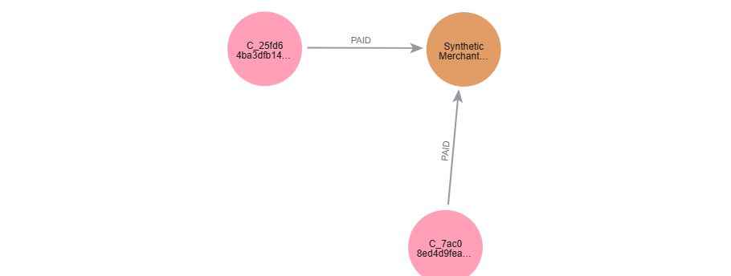

# SENTINEL – Fraud Detection Using Neo4j Graph Database

## 1. Project Overview

This project models SENTINEL transaction data using Neo4j, a graph database, to identify suspicious relationships between customers, devices, and merchants.

The graph helps investigate patterns such as:
- Multiple customers using the same device.
- Customers connected to fraud-labelled transactions.
- Merchants receiving payments through shared devices.

## 2. Technologies Used

- Python
- Neo4j 5
- Neo4j Python Driver
- Supabase
- Docker
- Cypher Query Language
- python-dotenv

## 3. Graph Data Model

### Nodes

| Node | Description | Unique Property |
|---|---|---|
| Customer | Represents a customer | customer_id |
| Device | Represents a device | device_id |
| Merchant | Represents a merchant | merchant_id |

### Relationships

**USED_DEVICE**

Connects a Customer to a Device.

Properties:
- transaction_id
- time

**PAID**

Connects a Customer to a Merchant.

Properties:
- transaction_id
- amount
- time
- fraud_label

## 4. Project Structure

```text
sentinel-neo4j-graph/
│
├── src/
│   ├── connection.py
│   ├── supabase_connection.py
│   ├── data_loader.py
│   ├── inspect_tables.py
│   └── graph_loader.py
│
├── screenshots/
│   └── suspicious_cluster.png
│
├── .env
├── .env.example
├── .gitignore
├── requirements.txt
└── README.md
```

## 5. Prerequisites

- Python installed
- Docker Desktop installed and running
- Neo4j Docker image
- Supabase project with SENTINEL dataset

## 6. Start Neo4j Using Docker

```bash
docker run -d \
  --name sentinel-neo4j \
  -p 7474:7474 \
  -p 7687:7687 \
  -v neo4j_data:/data \
  -e NEO4J_AUTH=neo4j/your_password \
  neo4j:5
```

Open Neo4j Browser:

```text
http://localhost:7474
```

Configure your `.env` file:

```env
NEO4J_URI=bolt://localhost:7687
NEO4J_USERNAME=neo4j
NEO4J_PASSWORD=your_password
NEO4J_DATABASE=neo4j

SUPABASE_URL=your_supabase_url
SUPABASE_KEY=your_supabase_key
```

Never commit your actual `.env` file or credentials.

## 7. Installation

Create and activate a virtual environment:

```bash
python -m venv .venv
```

Windows PowerShell:

```powershell
.venv\Scripts\Activate.ps1
```

Install dependencies:

```bash
pip install -r requirements.txt
```

## 8. Create Neo4j Constraints

Run:

```bash
python -m src.connection
```

This creates uniqueness constraints for Customer, Device, and Merchant IDs.

## 9. Load SENTINEL Data into Neo4j

Run:

```bash
python -m src.graph_loader
```

The loader:
1. Fetches transaction records from Supabase.
2. Selects at least 5,000 valid transactions.
3. Fetches associated labels, devices, and merchants.
4. Creates Customer, Device, and Merchant nodes.
5. Creates USED_DEVICE and PAID relationships.
6. Uses MERGE to make repeated loading idempotent.

### Loading Summary

| Metric | Result |
|---|---:|
| Valid transactions loaded | 5,000 |
| Fraud labels fetched | 5,000 |
| Devices fetched | 1,722 |
| Merchants fetched | 200 |

## 10. Fraud Investigation Using Cypher

### Query 1: Devices Shared by Three or More Customers Within Seven Days

The query checks device usage in the seven days preceding the latest transaction timestamp in the loaded dataset.

**Observed result:** No devices matched this condition.

### Query 2: Customers Within Two Hops of Fraud-Labelled Payments

This query identifies customers connected within one or two relationship hops to a fraud-labelled payment.

**Observed result:** Matching customer paths were found, including customers connected through a common merchant.

### Query 3: Merchants Paid Through Shared Devices

This query identifies merchants receiving payments through devices used by at least two customers.

**Observed result:** Ten merchants were returned in the top-ten results. The highest payment count was nine.

## 11. Suspicious Cluster Analysis

The graph investigation identified:

- A customer with a fraud-labelled payment to Synthetic Merchant 000134.
- Another customer who also paid the same merchant.
- The fraud-labelled transaction amount was 32,084.49.
- The second transaction amount was 13,289.99.

This shared merchant relationship is a potential investigation lead. It does not establish that the second customer is involved in fraud.

See `screenshots/suspicious_cluster.png` for the graph visualization.


## 12. Security

- Credentials are stored in `.env`.
- `.env` is excluded through `.gitignore`.
- `.env.example` contains placeholders only.
- Never publish API keys or database passwords.

## 13. Suspicious Cluster Visualization



## 14. Conclusion

This project demonstrates how Neo4j can represent transaction data as a graph and help investigate relationships between customers, devices, and merchants.

The graph model and Cypher queries provide a foundation for identifying potentially suspicious transaction patterns in the SENTINEL dataset.